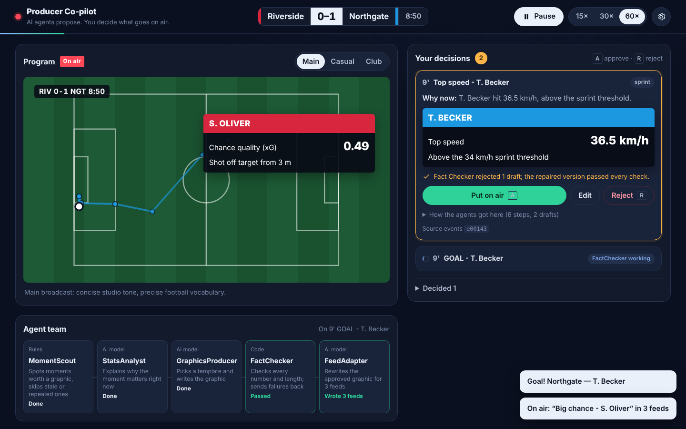
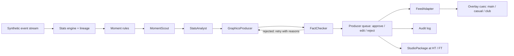

# Producer Co-pilot

An agent-assisted live graphics desk for football broadcasts. A team of AI agents watches a live (synthetic) match feed, proposes the right on-screen graphic at the right moment, explains why it matters now, and fact-checks every number before a human producer sees it. One approval puts the graphic on air in three feeds (main broadcast, casual streaming, club channel) as timed, machine-readable overlay cues.

Built for the Microsoft x Premier League **Inside the Game** developer hackathon. Category: **Best Multi-Agent System**.



## The problem

A live graphics producer has a few seconds to decide what goes on screen. Under that pressure, broadcasts fall back on generic numbers ("possession 58%") that tell viewers nothing new. The insight that explains a moment, such as "their press has won the ball high 4 times in 6 minutes", arrives too late or never. AI could help, but a hallucinated number on live TV is a serious problem, so AI output cannot go on air unchecked.

## What it does

| Stage | How |
| --- | --- |
| **Ingest** | A seeded synthetic match (passes, carries, shots, tackles, pressure, possession changes, fouls, metadata) is replayed as a live event stream at an adjustable speed. |
| **Interpret** | A deterministic stats engine computes possession, pass length, accuracy and a 0-100 difficulty rating, shot speed and xG, sprint speed, a rolling momentum index, and a control-vs-chaos index. Every value keeps the IDs of the events it came from. |
| **Explain** | The `StatsAnalyst` agent writes the "why now" for each moment: pressing, rhythm, game state, control vs chaos. |
| **Render** | The `GraphicsProducer` agent fills one of five broadcast templates within strict character limits. Approved graphics appear in the on-air preview and on `GET /api/overlays` as timed cues (`t_in`, `t_out`, template, slots, source events). |
| **Personalize** | The `FeedAdapter` agent rewrites each approved graphic for the main broadcast, a casual streaming audience, and a chosen club's channel. |

## The agent team



The pipeline is a [Microsoft Agent Framework](https://github.com/microsoft/agent-framework) workflow (`WorkflowBuilder`) with a cycle between the `GraphicsProducer` and the `FactChecker`.

- **MomentScout** (rules-based executor) drops stale moments and repeats of graphics already proposed.
- **StatsAnalyst** (LLM agent) explains why the moment matters, using only the verified facts.
- **GraphicsProducer** (LLM agent) picks a template and writes the slots.
- **FactChecker** (deterministic executor) rejects any number that isn't in the facts and any slot over its character limit, then sends its reasons back to the `GraphicsProducer`. After 3 rejected drafts it substitutes a verified template, so the queue never stalls.
- **FeedAdapter** (LLM agent) creates the three feed versions after approval. Each version is fact-checked again, and any feed that fails falls back to the approved wording.
- **StudioPackage** (LLM agent) builds a ranked half-time and full-time rundown plus a presenter script. The script's numbers are checked as well.

The human producer stays in control. Edits made by hand are fact-checked too, and every proposal, edit, approval and rejection is written to the audit log.

**Failure handling:** model errors, rate limits and unparseable replies all fall back to deterministic, verified templates, and the console keeps running. **Fault injection** (a toggle in the header) deliberately corrupts one number in each first draft, so you can watch the `FactChecker` catch it and the `GraphicsProducer` repair it.

## Microsoft technology

- **Microsoft Agent Framework (Python):** the agents, the workflow graph with its retry cycle, and the executors.
- **Model access:** Agent Framework's OpenAI-compatible chat client, so any compatible provider works, Microsoft Foundry included. Switching providers only means changing `LLM_BASE_URL`, `LLM_API_KEY` and `LLM_MODEL`.
- **Azure Container Apps:** hosts the public demo (`infra/deploy-azure.sh`); the model key is a Container Apps secret.
- **GitHub Codespaces:** a one-click environment for judges (`.devcontainer/`).
- **GitHub Copilot:** used while building the project.

## Using the console

1. Press **Start match**. The synthetic game replays at 15× (switch to 30× or 60× in the top bar).
2. The **Agent team** strip shows which agent is working on the current moment and whether the Fact Checker passed or rejected a draft.
3. **Your decisions** lists graphics waiting for you, highest priority first. The top card is expanded: read *Why now*, check the verification line, then **Put on air** (`A`), **Edit**, or **Reject** (`R`). Cards never move while your pointer is over the list, so you always act on the card you see.
4. Aired graphics appear on the **Program** monitor; switch between the **Main**, **Casual** and **Club** feeds to compare the three versions.
5. Open the settings (gear icon) to turn on **Fault test** and watch the Fact Checker reject a wrong number and the Graphics Producer repair it.

Every visitor gets their own console (match, queue and audit log), so several judges can test the public demo at the same time without affecting each other.

## Run it

Requires Python 3.12 and [uv](https://docs.astral.sh/uv/).

```bash
uv sync
cp .env.example .env          # optional: set LLM_BASE_URL / LLM_API_KEY / LLM_MODEL for live models
uv run uvicorn app.main:app --port 8000
```

Then open http://localhost:8000 and press **Start**.

- **With a model configured:** set `LLM_BASE_URL`, `LLM_API_KEY` and `LLM_MODEL` for any OpenAI-compatible API. `.env.example` has examples for OpenAI, Groq, Ollama and Microsoft Foundry. The agents call that model, and every reply is cached in `data/llm_cache.json`.
- **Without a token:** the app replays cached replies first, then uses verified template fallbacks, so the full workflow still runs.
- **Codespaces:** open the repo in a Codespace. Dependencies install automatically and port 8000 opens in the browser. Run the `uvicorn` command above.

Keyboard shortcuts: `a` approves and `r` rejects the highest-priority pending suggestion.

### Test instructions for judges

1. Start the server as shown above and press **Start**. 15x speed plays a full match in about 6 minutes.
2. Turn on **Fault injection**, then open a card's **Agent trace** to see a draft rejected and repaired.
3. Press **Approve to air** on a card, then switch the on-air preview between **main**, **casual** and **club**.
4. Press **Edit** on a card and type a number that isn't in the facts. The Fact Checker blocks the edit.
5. Open http://localhost:8000/api/overlays to see the machine-readable cue sheet, or `/api/audit` for the audit log.

## Deploy to Azure Container Apps

From Azure Cloud Shell (no local Docker needed):

```bash
git clone <this repo> && cd pl-football-hackathon
bash infra/deploy-azure.sh                       # deterministic templates only
LLM_BASE_URL=https://<resource>.openai.azure.com/openai/v1/ LLM_API_KEY=<key> LLM_MODEL=<deployment> \
  bash infra/deploy-azure.sh                     # with a Microsoft Foundry model
```

The API key is stored as a Container Apps secret, never in the image or the repository. The app runs on one replica because each visitor's console is kept in memory.

## Synthetic data

`app/generator.py` is a seeded possession state machine: zone-dependent pass, carry and shot probabilities, team pressing spells, and player passing, finishing and pace ratings. Its output is tuned so each match lands near typical top-flight averages: about 400-500 passes per team at about 80% accuracy, 9-16 shots per team, and realistic xG and shot speeds. The clubs, players and venue are all fictional; player names come from Faker. The same seed always produces the same match.

```bash
uv run python -m app.generator --seed 1    # writes data/match_1.json
```

## API

| Method | Path | Purpose |
| --- | --- | --- |
| GET | `/api/stream` | Server-sent events: match events, stats, suggestions, agent trace, overlays, audit entries, packages |
| GET | `/api/state` | Full console state |
| POST | `/api/control` | `{action: start, pause or reset, speed, inject_faults, club}` |
| POST | `/api/suggestions/{id}/approve` | Approve, optionally with edited `slots` (these are fact-checked) |
| POST | `/api/suggestions/{id}/reject` | Reject with a reason |
| GET | `/api/overlays?feed=main` | Timed overlay cues for a graphics engine |
| GET | `/api/audit` | Audit log |
| POST | `/api/package` | Build a studio package on demand |

## Tests

```bash
uv run pytest
```

The tests cover how realistic and deterministic the generated data is, that every fallback graphic passes the fact check, that the Fact Checker rejects invented numbers and over-long slots, and that the workflow recovers from an injected fault.

## Limitations

- The data is synthetic and event-level only. There is no video and no automatic event tagging from video.
- Possession is measured by time between possession changes, a simplification of real possession models.
- Model calls are spaced out (`LLM_MIN_INTERVAL_S`) and cached, so with a slow or rate-limited provider some lower-priority moments may be dropped while the agents are busy.

## Credits

Original concept, agents and simulation by Dimas Wahyu Saputro ([diwahsap](https://github.com/diwahsap)). Console redesign, per-visitor sessions and Azure deployment added by [Albategnius](https://github.com/Albategnius). Same team.

## License

MIT
